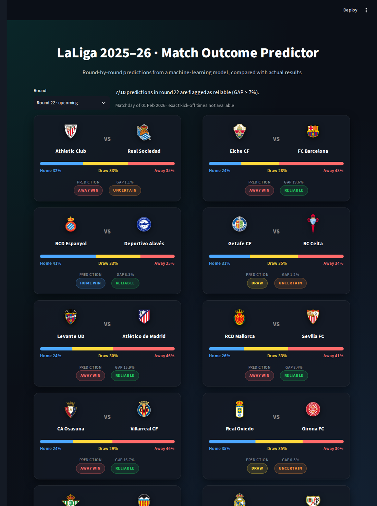
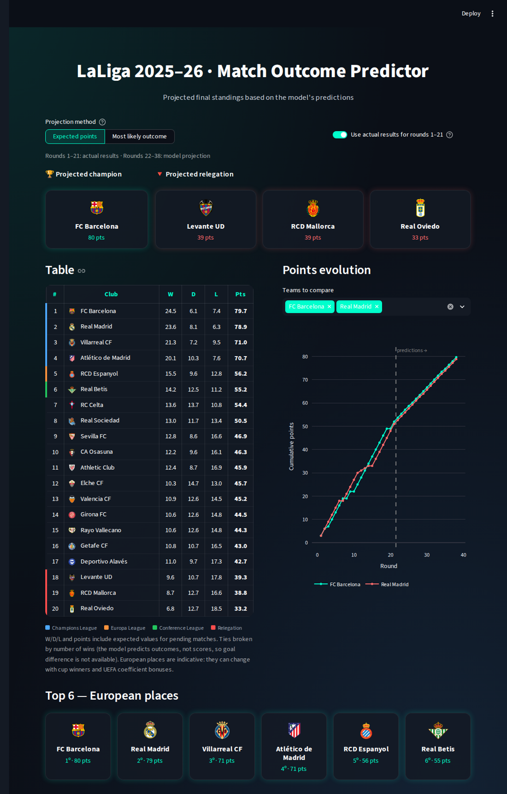
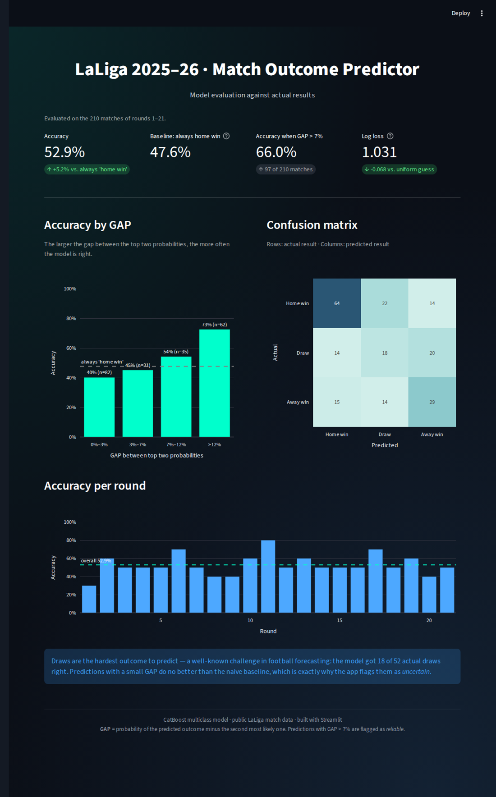

# ⚽ LaLiga 2025–26 Match Outcome Predictor

Interactive Streamlit dashboard that presents the predictions of a machine-learning model (CatBoost, multiclass) for every match of the 2025–26 LaLiga season, projects the final standings, and evaluates the model against the results already played.



## Highlights

| | |
|---|---|
| **Accuracy** on the 210 matches played (rounds 1–21) | **52.9%**, vs. 47.6% for the naive "always home win" baseline and 33.3% for random guessing |
| **Accuracy on "reliable" predictions** (GAP > 7%, 97 matches) | **66.0%** |
| **Accuracy when GAP > 12%** | **72.6%** |
| **Log loss** | 1.031, vs. 1.099 for a uniform 1/3–1/3–1/3 guess |

The key finding is that the model's confidence is meaningful. Accuracy rises steadily with the GAP between the two most likely outcomes, from 40% to 45% to 54% to 73% across the GAP buckets. This is what justifies flagging low-GAP predictions as *uncertain* in the app.

## What the app does

The app has three pages:

- **Match predictions.** Pick any round to see each fixture with the model's probabilities (home / draw / away), the predicted outcome and a *reliable / uncertain* flag. For rounds already played, each card shows the actual result and whether the model got it right.
- **Projected standings.** Projects the final table by combining actual results with the model's predictions for the remaining rounds. The table can be built two ways:
  - *Expected points* (default): each pending match contributes 3·P(win) + P(draw). This gives realistic point totals.
  - *Most likely outcome*: each pending match counts as its most probable result. It is simpler to read, but it inflates the favourites (around 100 points), because they never drop points.

  You can also switch off the actual results to see what the model alone projected for the whole season. The page shows the champion, the relegation zone, the European places and a points-evolution chart for up to six teams.
- **Model performance.** Shows accuracy against baselines, accuracy by GAP bucket, the confusion matrix and accuracy per round.





## Key concept: GAP

**GAP** is the probability of the predicted outcome minus the second most likely outcome. For example, with probabilities of 48% / 28% / 24%, the GAP is 20%. The app flags a prediction as *reliable* when GAP > 7%. You can change this threshold in `core/config.py`.

## Data

| File | Content |
|---|---|
| `data/predictions_2025_26.csv` | Model output for all 380 fixtures: `predicted_result`, `p_home`, `p_draw`, `p_away`, `confidence` (max probability) and `gap` |
| `data/results_2025_26.csv` | Actual results of rounds 1–21 (`HOME_WIN` / `DRAW` / `AWAY_WIN`) |
| `data/historical_matches_sample.csv` | Sample (1,000 rows) of the team-level match statistics used for feature engineering: xG, possession, shots, formation, referee, etc. Not used by the app |

The match data comes from public LaLiga statistics. Team crests belong to their respective clubs and are used here only for non-commercial, illustrative purposes.

> **Note on evaluation.** All 380 predictions were generated at the same time. Rounds 22–38 are genuine forecasts. The figures for rounds 1–21 compare those predictions with the real outcomes.

## Project structure

```
├── app.py                    # Entry point (page navigation)
├── core/
│   ├── config.py             # Paths, GAP threshold, league constants
│   ├── data.py               # Loading, standings, expected points, evaluation metrics (pure, tested)
│   ├── teams.py              # Display names and crests
│   └── ui.py                 # Shared CSS and HTML helpers
├── views/
│   ├── matches.py            # Match predictions page
│   ├── standings.py          # Projected standings page
│   └── model_performance.py  # Model evaluation page
├── data/                     # CSV datasets
├── assets/logos/             # Team crests
├── tests/test_data.py        # Unit tests for the analytics logic
└── .streamlit/config.toml    # Dark theme
```

The analytics logic in `core/data.py` is kept separate from the UI. That makes it testable with pytest and reusable outside Streamlit.

## Run it locally

```bash
git clone <this-repo-url>
cd laliga-match-predictor
python -m venv .venv && source .venv/bin/activate   # Windows: .venv\Scripts\activate
pip install -r requirements.txt
streamlit run app.py
```

To run the tests:

```bash
pip install pytest
pytest
```

## Limitations and next steps

- **Draws are hard.** The model predicts only 18 of 52 actual draws correctly, which is a well-known difficulty in football forecasting.
- **No goal difference.** The model predicts outcomes, not scores, so standings ties are broken by number of wins instead of goal difference.
- **Possible improvements:**
  - Monte Carlo simulation of the remaining season, to get probabilities of winning the title, qualifying for Europe or being relegated.
  - Probability calibration analysis.
  - Retraining the model as each new round is played.

## Author

**Maria Sans Bosch**, Data Science & Engineering (UPC) · MSc in Business Analytics (ESADE).

This project was developed in the Sports Analytics area during my Consulting IT internship at RSM (2025–26).
